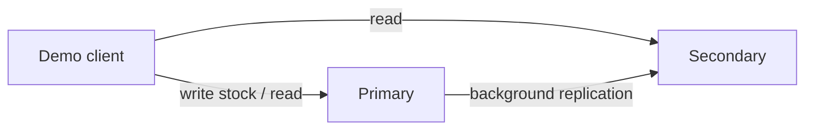
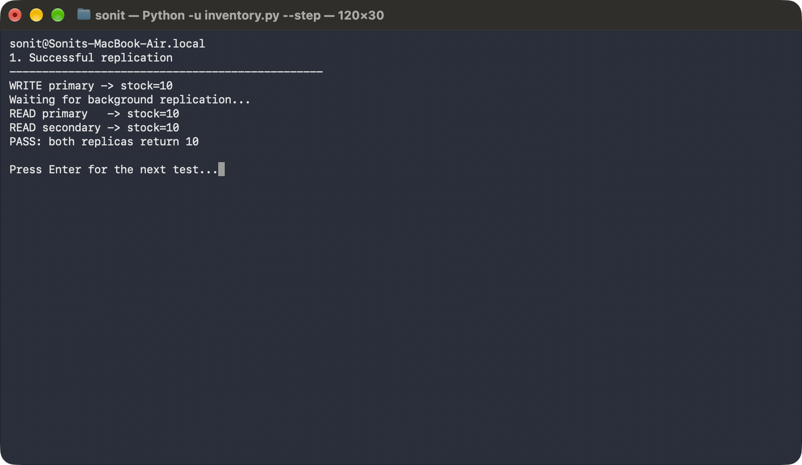
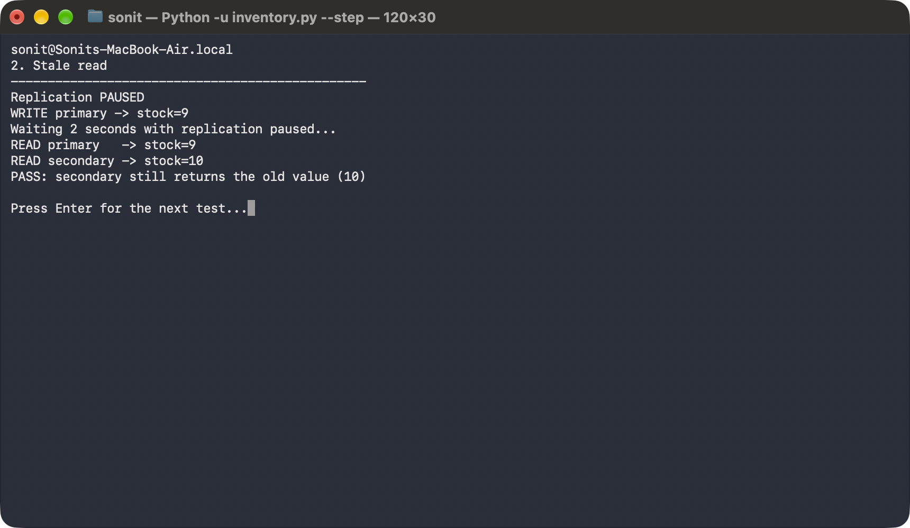
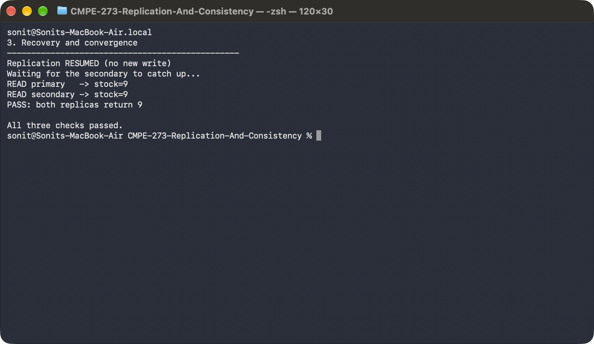

# Inventory Replication and Consistency

A small Python lab with one Primary, one Secondary, and a demo client that reads either replica. Writes go to the Primary; a background worker copies its stock to the Secondary every 0.5 seconds.

## Architecture



Both replicas run in one process with separate inventory values. A lock protects reads, writes, and replication. State is kept in memory and resets each run.

## Run the lab

Requires Python 3. No packages to install. From this directory, run:

```sh
python3 inventory.py
```

The demo performs these steps and checks the returned values with assertions:

1. Write `10` to the Primary and wait for the Secondary to receive it.
2. Read both replicas and verify that both return `10`.
3. Pause replication, write `9` to the Primary, and wait two seconds.
4. Verify that the Primary returns `9` while the Secondary still returns `10`.
5. Resume replication and verify that both return `9` without another write.

The program exits after the checks and stops its worker. A replication wait fails after five seconds if the Secondary does not catch up.

## Evidence

The demo was run on `sonit@Sonits-MacBook-Air.local`; all three checks passed.

| Test | Primary | Secondary | Result |
| --- | --- | --- | --- |
| Successful replication | 10 | 10 | Same value after replication |
| Stale read, replication paused | 9 | 10 | Secondary returns the older value |
| Recovery, replication resumed | 9 | 9 | Replicas converge without another write |

### Successful replication

The Primary accepts the write and both replicas return `10`.



### Stale read

With replication paused, the Primary returns `9` and the Secondary still returns `10`.



### Recovery and convergence

Once replication resumes, both replicas return `9` without another write.



## Reflection

Reading from a nearby replica can be fast because the client does not have to wait for the Primary. With asynchronous replication, that replica may still hold an older value when a write has just happened. Guaranteeing the latest value requires coordinating with the Primary or waiting until the replica has caught up, which can increase latency and may block reads during a connection failure. For inventory, a stale read might be acceptable when browsing, but confirming a purchase needs a current stock check.

<!-- AI use acknowledgment: AI tools helped develop, test, and document this lab. -->
